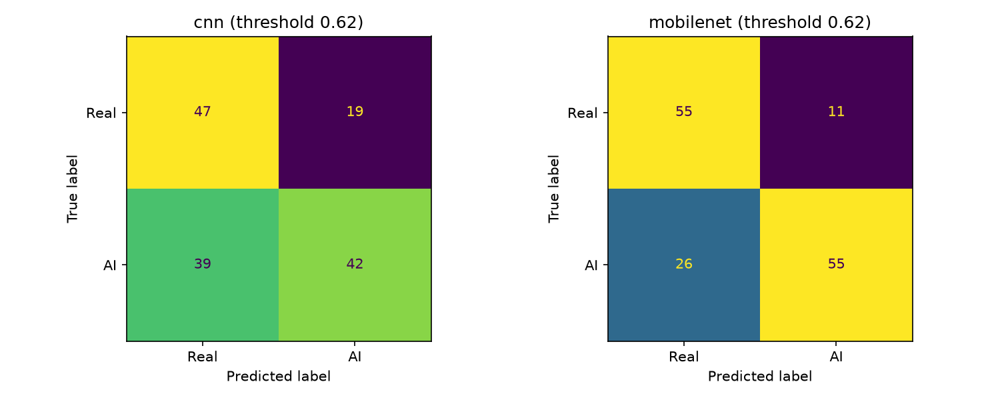
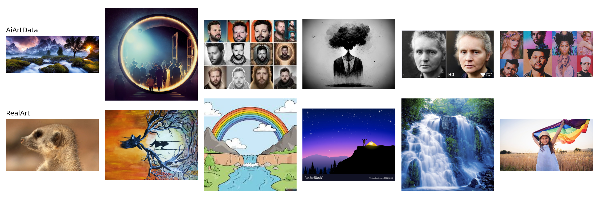
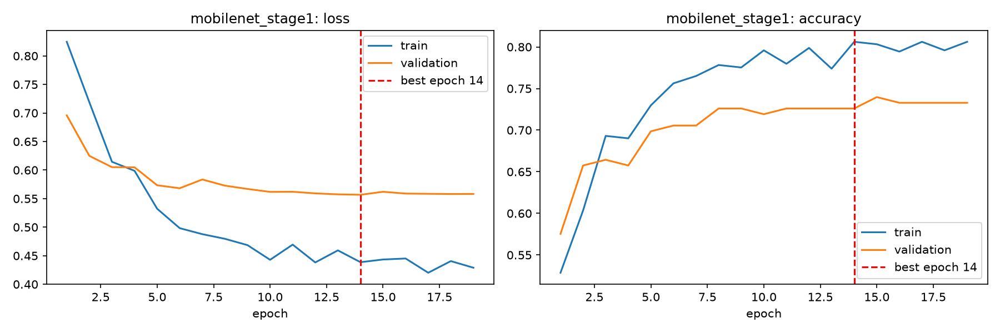
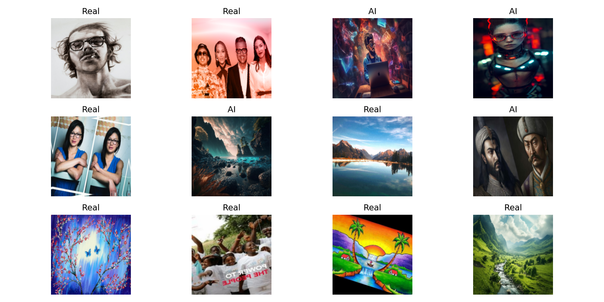
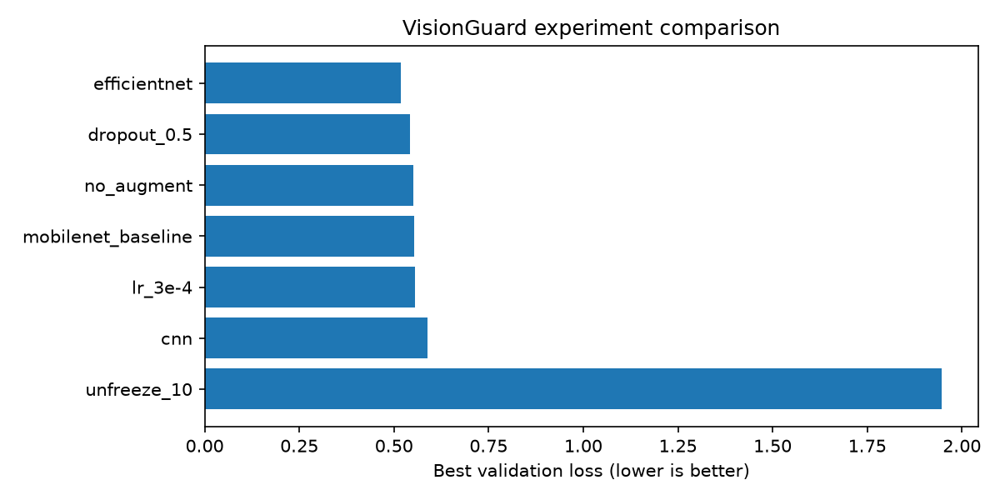

# 🛡️ VisionGuard — AI-Generated vs Real Image Detection


An end-to-end MLOps project. You upload an image and VisionGuard tells you whether it is
**AI-generated or real**, with a confidence score, an "uncertain" warning near the
decision boundary, and an honest caveat. Every prediction is logged to a database.

The project covers the full lifecycle: data audit and versioning (DVC), model
training and tuning (TensorFlow/Keras, Keras Tuner), experiment tracking and model
registry (MLflow on DagsHub), a validated Flask web app, PostgreSQL, Docker Compose,
CI (GitHub Actions) and a serverless model API on Vercel.

| | |
|---|---|
| 🌐 Model API | https://l230729-a2-ops.vercel.app/health |
| 📊 Experiments, data & registry | [DagsHub · l230729__A2_Ops](https://dagshub.com/FaizanNaroo/l230729__A2_Ops) |

---

## Architecture

```
                         ┌──────────────── Docker Compose ────────────────┐
Browser ── upload ──▶    │  Flask web app ──SQLAlchemy──▶ PostgreSQL       │
                         │   validate, log      (named volume, no port)   │
                         └───────┬────────────────────────────────────────┘
                                 │ HTTPS + X-API-Key   (INFERENCE_MODE=remote)
                                 ▼
                     Vercel serverless function
                     TFLite EfficientNetB0 (ai-edge-litert)
```

* **Two inference modes behind one interface.** `INFERENCE_MODE=local` loads the Keras
  champion model inside Flask. `INFERENCE_MODE=remote` forwards the image bytes to
  the Vercel API. The views, database and templates are the same in both modes.
* **No training/serving skew.** One shared `decode_and_resize` function is used by
  both training and serving. On Vercel, where TensorFlow does not fit, the bilinear
  resize is re-implemented in NumPy, and `verify_tflite.py` checks it gives the same
  probabilities as Keras.
* **Model delivery.** `visionguard@champion` is pulled from the MLflow registry once
  (`export_champion.py`). The app never calls DagsHub per request.

## Results

974 unique images (Kaggle *AI Generated Images vs Real Images*), stratified 70/15/15
split, seed 42. Each experiment changes one thing, and the model is selected on
**validation** loss only. The test set was used once.

| Run | Change | Val loss | Test acc | Test precision | Test ROC-AUC |
|---|---|---|---|---|---|
| **efficientnet** ⭐ | EfficientNetB0, frozen base | **0.518** | **0.762** | **0.897** | **0.864** |
| dropout_0.5 | MobileNetV2, dropout 0.5 | 0.543 | 0.701 | 0.894 | 0.852 |
| mobilenet_baseline | MobileNetV2, frozen base | 0.554 | 0.721 | 0.803 | 0.835 |
| lr_3e-4 | learning rate 3e-4 | 0.555 | 0.762 | 0.838 | 0.854 |
| no_augment | augmentation off | 0.551 | 0.626 | 0.842 | 0.838 |
| cnn | CNN from scratch | 0.588 | 0.626 | 0.686 | 0.686 |
| unfreeze_10 | last 10 layers trainable | 1.946 | 0.735 | 0.850 | 0.832 |

Calling a real photo "fake" is treated as the worse error, so the threshold is
chosen on validation data to maximise **F0.5**, which favours precision.

| ROC curves | Confusion matrices |
|---|---|
|  |  |

**Most confident mistakes.** The model judges *style* more than generation
artefacts. Glossy or painterly real images get flagged as AI, while photorealistic
AI images pass as real.


### Key findings
* Fine-tuning hurt. With only 681 training images, unfreezing any layers overfitted
  within an epoch. Keras Tuner (10 trials) confirmed that a frozen base works best,
  and the number of unfrozen layers mattered most.
* The first CNN predicted a single class because BatchNorm running statistics lagged
  behind with only 22 steps per epoch. Lowering the momentum to 0.9 fixed it.
* PNG is 20% of AI images but only 8% of real images. This is a possible shortcut
  and a documented dataset limitation.

## 📄 Full report

The complete write-up (42 pages, with every screenshot, figure and design decision)
is in [`docs/23L0729_VisionGuard.pdf`](docs/23L0729_VisionGuard.pdf).

## Work done, stage by stage

<details>
<summary><b>1. Data understanding and versioning</b></summary>

* **Environment:** Python 3.11.9 venv, TensorFlow 2.21 (CPU only, because native
  Windows has no GPU support from TF 2.11 onwards). Exact versions are frozen in
  `requirements.txt`.
* **Audit (`audit.py` → `audit.csv`):** records class, file size, width, height,
  colour mode, format and SHA-256 for every image. Every file is fully decoded
  (`img.load()`) to detect corruption.
  * 975 images: 539 AI and 436 real (55/45).
  * 0 corrupt files.
  * 1 exact duplicate pair (dropped when the splits are made).
  * No hash shared between the two classes.
  * 4 colour modes (RGB, RGBA, P, L), JPEG and PNG, sizes from 135 px to 8495 px.
* **EDA (`eda.py`):** a sample grid and log-scale histograms. AI images peak around
  1000–1300 px wide. PNG is 20% of AI images but only 8% of real ones, a possible
  shortcut for the model.
* **DVC:** practised in a toy repo (two data versions, checkout back, push to DagsHub,
  delete the local cache, pull it back). Applied with `dvc add data/raw`: a 504 MB
  folder becomes one small `data/raw.dvc` pointer in Git, and the data lives in
  DagsHub storage.


</details>

<details>
<summary><b>2. Model development (TensorFlow/Keras)</b></summary>

* **Splits (`make_splits.py`):** stratified 70/15/15 into 681/146/147 images, saved as
  CSVs so every run uses the same data.
* **`tf.data` pipeline (`pipeline.py`):**
  * decode to 3-channel RGB and resize to 224×224 (stretching, not padding)
  * `cache`, then shuffle, batch(32) and augmentation for the training set only
    (flip, ±5% rotation, 10% zoom), then `prefetch`
  * pixels stay 0–255; each model rescales inside its own graph, so serving cannot
    get the scaling wrong.
* **Baseline CNN:** 4 × (Conv2D → BatchNorm → MaxPool), then GAP, Dropout 0.3 and a
  sigmoid output, 390 K parameters. Trained with binary cross-entropy and Adam;
  accuracy, precision, recall and AUC are tracked.
* **Transfer learning:** MobileNetV2 and EfficientNetB0 with ImageNet weights.
  * Stage 1 trains only the head, with the base frozen.
  * Stage 2 unfreezes the last block at a 100× smaller learning rate. It overfitted
    from epoch 1, so the frozen model was kept.
* **Training discipline:** seed 42 with op determinism, EarlyStopping,
  ModelCheckpoint on `val_loss` and ReduceLROnPlateau.
* **Evaluation:** the threshold is chosen on validation data by F0.5, because a false
  "fake" on a real photo is the worse error. The test set is evaluated once.
* **Error analysis:** the 10 most confident mistakes, each with a hypothesis (style,
  collage, CGI, resolution, label noise).
* **Keras Tuner:**
  * Toy run: Fashion-MNIST.
  * VisionGuard run: 10 trials over learning rate, dropout and unfrozen layers.
  * The number of unfrozen layers mattered most, and a frozen base was best.

| Training curves | Augmented batch |
|---|---|
|  |  |
</details>

<details>
<summary><b>3. Experiment tracking (MLflow on DagsHub)</b></summary>

* **Local MLflow lab:** two learning rates compared side by side in the MLflow UI.
* **DagsHub:** the tracking URI and token come only from environment variables
  (`.env` is git-ignored).
* **`train_mlflow.py` has two tracking modes:**
  * **Manual:** a Keras callback logs metrics per epoch, plus project parameters,
    the threshold, test metrics and artifacts (confusion matrix, ROC curve, split
    CSVs, `requirements.txt`, the model with its signature).
  * **Autolog:** `mlflow.tensorflow.autolog()`.
  * Both modes tag each run with `git_commit`, `dvc_data_version` and `seed`.
* **Comparison:** 7 runs, each changing one thing (see the results table above).
  EfficientNetB0 wins on validation loss, F0.5 and AUC.
* **Model registry:** `visionguard` versions with the aliases **`@champion`**
  (EfficientNetB0, threshold 0.74) and `@challenger`. `predict_champion.py` loads the
  model by alias.


</details>

<details>
<summary><b>4–5. Flask web app and database trail</b></summary>

* `inference.py` loads the champion once at start-up. Loading takes about 2 s and a
  prediction about 0.4 s, so loading per request would be unacceptable.
* Routes:
  * `/`: upload page
  * `/predict`: validation, then Post/Redirect/Get to the result
  * `/result/<id>`: one stored prediction
  * `/history`: past predictions from the database
  * `/health`: JSON status, including a live `SELECT 1` database check
  * `/api/history`: the history as JSON
* Rejected uploads: wrong extension, fake images, files over the size limit.
  `secure_filename` cleans file names, error pages are friendly, and nothing is
  written to disk.
* All configuration comes from environment variables, and debug mode is off: the
  debug console allows remote code execution and leaks internal details.
* Flask-SQLAlchemy `predictions` table stores label, P(AI), confidence, the uncertain
  flag, threshold, model, a UTC timestamp, latency and the image's SHA-256.
  * SQLite during development, PostgreSQL in Docker.
</details>

<details>
<summary><b>6. Docker, Compose and CI</b></summary>

* **Dockerfile:**
  * `python:3.11-slim` base, with dependencies installed before the code is copied,
    so code edits reuse the cached layer.
  * Runs as non-root `appuser`, has a `HEALTHCHECK` and a `.dockerignore`, and keeps
    secrets out of the image.
* **Compose:**
  * `db` (postgres:16-alpine) has a named volume and a `pg_isready` health check, and
    publishes **no port**.
  * `web` waits for `service_healthy` and reaches the database at `db:5432`.
  * The model is mounted read-only.
* **Image analysis:** the pip/TensorFlow layer is 2.28 GB. Switching to the slim base
  shrank the image from 4.55 GB to 3.14 GB (−31%).
* **Operations:** practised stop, start, restart, logs and a shell in each service,
  plus a deliberate failure diagnosed from the logs.
* **GitHub Actions:**
  * A toy repo with a Python 3.11/3.12 matrix, with one red run and one green run.
  * The project workflow runs flake8 and pytest (17 tests), then builds the Docker
    image.
</details>

<details>
<summary><b>7–8. Cloud model API and Flask integration</b></summary>

* Full TensorFlow is too large for a Vercel function. The champion is converted to
  **TFLite** (`export_tflite.py`) and served with `ai-edge-litert` from
  `vercel_api/api/index.py`.
  * Preprocessing re-implements `tf.image.resize` in NumPy.
  * `verify_tflite.py` confirms that Keras and TFLite give the same probabilities.
* API endpoints:
  * `GET /health`: model name and threshold.
  * `POST /predict`: needs the `X-API-Key` header, checked in constant time.
    Uploads are limited to 4 MB and every failure returns a JSON error.
* **Vercel routing problem:** the rewrite sent every request to the same path, so
  Flask's routes stopped matching. It was diagnosed with a temporary debug route and
  fixed with a small WSGI middleware that restores the original path.
* **Integration (`INFERENCE_MODE=remote`):** `RemoteClassifier` reuses one HTTP
  session and maps API outcomes to the right page.
  * 400 or 413 (bad image) → "Upload rejected"
  * 401 (wrong key), 5xx, or a timeout → a 503 "service unavailable" page
  * Only successful predictions are stored. `/health` reports whether the API is
    reachable.
* **End-to-end run** (`task8_demo.py`): 8 test images went from Flask to Vercel to
  PostgreSQL, with about 1.5 s per round trip (model inference is about 25 ms).
  Results are in `reports/task8_results.csv`.
* Postman collection: 8 requests with assertions, covering 401, 400 and 404 cases.
</details>

## Web app

* Upload → result page (verdict, confidence, P(AI), threshold, model, latency and a
  caveat) → history page backed by the database. `/health` and `/api/history`
  return JSON.
* Validation checks the extension, the real image content (Pillow verify) and the
  size limit, and sanitises file names. Images are processed in memory only; just
  the SHA-256 hash is stored.
* Every row records **what** was decided, **when**, **by which model** and **how
  confidently**.
* The model API requires a secret key (compared in constant time). Uploads are
  capped below Vercel's request body limit, and an API outage shows a clear 503
  page instead of crashing.

## Quick start

```bash
git clone https://github.com/FaizanNaroo/l230729__A2_Ops.git
cd l230729__A2_Ops
cp .env.example .env            # fill in passwords, API_URL and API_KEY

# Option A: remote inference (uses the deployed Vercel API, no model download needed)
docker compose up -d --build    # open http://localhost:5000

# Option B: local inference
python export_champion.py       # pulls visionguard@champion from the MLflow registry
# set INFERENCE_MODE=local in .env, then:
docker compose up -d --build
```

Send several labelled test images through the whole stack:

```bash
python task8_demo.py -n 8       # Flask → Vercel → PostgreSQL, prints true vs predicted
```

Tests and lint (they also run in CI, along with the Docker build):

```bash
pytest -q
flake8 app.py db.py inference.py preprocessing.py task8_demo.py tests --max-line-length 120
```

## Deploying the model API (Vercel)

```bash
python export_tflite.py         # Keras → TFLite into vercel_api/model/
python verify_tflite.py         # Keras and TFLite probabilities must match
cd vercel_api
vercel link                     # project: l230729-a2-ops
vercel env add API_KEY production
vercel --prod
```

A Postman collection with assertions for every endpoint and error case is in
[`postman/`](postman/VisionGuard_API.postman_collection.json).

## Project map

| Stage | Files |
|---|---|
| Data audit & EDA | `audit.py`, `eda.py`, `make_splits.py`, `data/raw.dvc` (DVC on DagsHub) |
| Input pipeline | `pipeline.py`, `preprocessing.py`, `show_batch.py` |
| Models & training | `models.py`, `train.py`, `train_mlflow.py` (manual + autolog tracking) |
| Evaluation | `evaluate.py`, `error_analysis.py`, `reports/` |
| Tuning | `tuner_toy.py`, `tune_visionguard.py` |
| Tracking & registry | `mlflow_toy.py`, `compare_runs.py`, `register_model.py`, `predict_champion.py` |
| Serving | `app.py`, `inference.py`, `db.py`, `templates/`, `static/` |
| Model API | `vercel_api/` (serverless, TFLite), `api.py` + `Dockerfile.api` (container alternative) |
| Containers & CI | `Dockerfile`, `compose.yaml`, `.github/workflows/ci.yml`, `tests/` |

## Limitations

The model reaches about 76% accuracy on a small, scraped dataset whose generators
predate current models. Images from modern generators are out of distribution, and
some labels in the dataset are noisy. Treat a verdict as a hint, never as proof.
