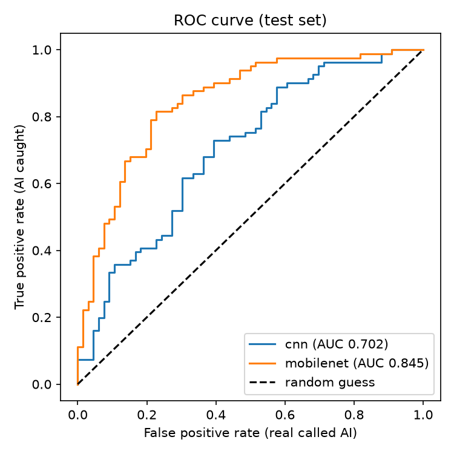
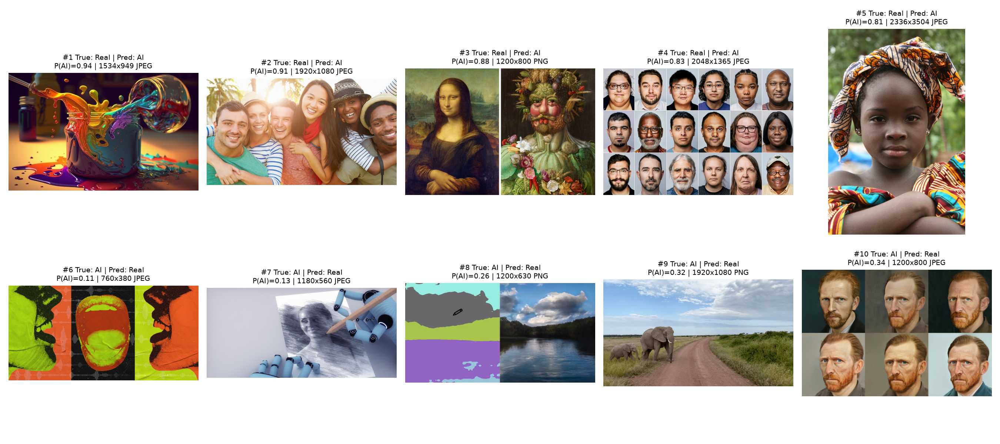

# 🛡️ VisionGuard — AI-Generated vs Real Image Detection


An end-to-end MLOps project. You upload an image and VisionGuard tells you whether it is
**AI-generated or real**, with a confidence score, an "uncertain" warning near the
decision boundary, and an honest caveat. Every prediction is logged to a database.

The project covers the full lifecycle: data audit and versioning (DVC), model
training and tuning (TensorFlow/Keras, Keras Tuner), experiment tracking and model
registry (MLflow on DagsHub), a validated Flask web app, PostgreSQL, Docker Compose,
CI (GitHub Actions) and a serverless model API on Vercel.

| | |
|---|---|
| 🌐 Model API | https://l230729-a2-ops.vercel.app/health |
| 📊 Experiments, data & registry | [DagsHub · l230729__A2_Ops](https://dagshub.com/FaizanNaroo/l230729__A2_Ops) |

---

## Architecture

```
                         ┌──────────────── Docker Compose ────────────────┐
Browser ── upload ──▶    │  Flask web app ──SQLAlchemy──▶ PostgreSQL       │
                         │   validate, log      (named volume, no port)   │
                         └───────┬────────────────────────────────────────┘
                                 │ HTTPS + X-API-Key   (INFERENCE_MODE=remote)
                                 ▼
                     Vercel serverless function
                     TFLite EfficientNetB0 (ai-edge-litert)
```

* **Two inference modes behind one interface.** `INFERENCE_MODE=local` loads the Keras
  champion model inside Flask. `INFERENCE_MODE=remote` forwards the image bytes to
  the Vercel API. The views, database and templates are the same in both modes.
* **No training/serving skew.** One shared `decode_and_resize` function is used by
  both training and serving. On Vercel, where TensorFlow does not fit, the bilinear
  resize is re-implemented in NumPy, and `verify_tflite.py` checks it gives the same
  probabilities as Keras.
* **Model delivery.** `visionguard@champion` is pulled from the MLflow registry once
  (`export_champion.py`). The app never calls DagsHub per request.

## Results

974 unique images (Kaggle *AI Generated Images vs Real Images*), stratified 70/15/15
split, seed 42. Each experiment changes one thing, and the model is selected on
**validation** loss only. The test set was used once.

| Run | Change | Val loss | Test acc | Test precision | Test ROC-AUC |
|---|---|---|---|---|---|
| **efficientnet** ⭐ | EfficientNetB0, frozen base | **0.518** | **0.762** | **0.897** | **0.864** |
| dropout_0.5 | MobileNetV2, dropout 0.5 | 0.543 | 0.701 | 0.894 | 0.852 |
| mobilenet_baseline | MobileNetV2, frozen base | 0.554 | 0.721 | 0.803 | 0.835 |
| lr_3e-4 | learning rate 3e-4 | 0.555 | 0.762 | 0.838 | 0.854 |
| no_augment | augmentation off | 0.551 | 0.626 | 0.842 | 0.838 |
| cnn | CNN from scratch | 0.588 | 0.626 | 0.686 | 0.686 |
| unfreeze_10 | last 10 layers trainable | 1.946 | 0.735 | 0.850 | 0.832 |

Calling a real photo "fake" is treated as the worse error, so the threshold is
chosen on validation data to maximise **F0.5**, which favours precision.

| ROC curves | Confusion matrices |
|---|---|
|  |  |

**Most confident mistakes.** The model judges *style* more than generation
artefacts. Glossy or painterly real images get flagged as AI, while photorealistic
AI images pass as real.



### Key findings
* Fine-tuning hurt. With only 681 training images, unfreezing any layers overfitted
  within an epoch. Keras Tuner (10 trials) confirmed that a frozen base works best,
  and the number of unfrozen layers mattered most.
* The first CNN predicted a single class because BatchNorm running statistics lagged
  behind with only 22 steps per epoch. Lowering the momentum to 0.9 fixed it.
* PNG is 20% of AI images but only 8% of real images. This is a possible shortcut
  and a documented dataset limitation.

## Web app

* Upload → result page (verdict, confidence, P(AI), threshold, model, latency and a
  caveat) → history page backed by the database. `/health` and `/api/history`
  return JSON.
* Validation checks the extension, the real image content (Pillow verify) and the
  size limit, and sanitises file names. Images are processed in memory only; just
  the SHA-256 hash is stored.
* Every row records **what** was decided, **when**, **by which model** and **how
  confidently**.
* The model API requires a secret key (compared in constant time). Uploads are
  capped below Vercel's request body limit, and an API outage shows a clear 503
  page instead of crashing.

## Quick start

```bash
git clone https://github.com/FaizanNaroo/l230729__A2_Ops.git
cd l230729__A2_Ops
cp .env.example .env            # fill in passwords, API_URL and API_KEY

# Option A: remote inference (uses the deployed Vercel API, no model download needed)
docker compose up -d --build    # open http://localhost:5000

# Option B: local inference
python export_champion.py       # pulls visionguard@champion from the MLflow registry
# set INFERENCE_MODE=local in .env, then:
docker compose up -d --build
```

Send several labelled test images through the whole stack:

```bash
python task8_demo.py -n 8       # Flask → Vercel → PostgreSQL, prints true vs predicted
```

Tests and lint (they also run in CI, along with the Docker build):

```bash
pytest -q
flake8 app.py db.py inference.py preprocessing.py task8_demo.py tests --max-line-length 120
```

## Deploying the model API (Vercel)

```bash
python export_tflite.py         # Keras → TFLite into vercel_api/model/
python verify_tflite.py         # Keras and TFLite probabilities must match
cd vercel_api
vercel link                     # project: l230729-a2-ops
vercel env add API_KEY production
vercel --prod
```

A Postman collection with assertions for every endpoint and error case is in
[`postman/`](postman/VisionGuard_API.postman_collection.json).

## Project map

| Stage | Files |
|---|---|
| Data audit & EDA | `audit.py`, `eda.py`, `make_splits.py`, `data/raw.dvc` (DVC on DagsHub) |
| Input pipeline | `pipeline.py`, `preprocessing.py`, `show_batch.py` |
| Models & training | `models.py`, `train.py`, `train_mlflow.py` (manual + autolog tracking) |
| Evaluation | `evaluate.py`, `error_analysis.py`, `reports/` |
| Tuning | `tuner_toy.py`, `tune_visionguard.py` |
| Tracking & registry | `mlflow_toy.py`, `compare_runs.py`, `register_model.py`, `predict_champion.py` |
| Serving | `app.py`, `inference.py`, `db.py`, `templates/`, `static/` |
| Model API | `vercel_api/` (serverless, TFLite), `api.py` + `Dockerfile.api` (container alternative) |
| Containers & CI | `Dockerfile`, `compose.yaml`, `.github/workflows/ci.yml`, `tests/` |

## Limitations

The model reaches about 76% accuracy on a small, scraped dataset whose generators
predate current models. Images from modern generators are out of distribution, and
some labels in the dataset are noisy. Treat a verdict as a hint, never as proof.
